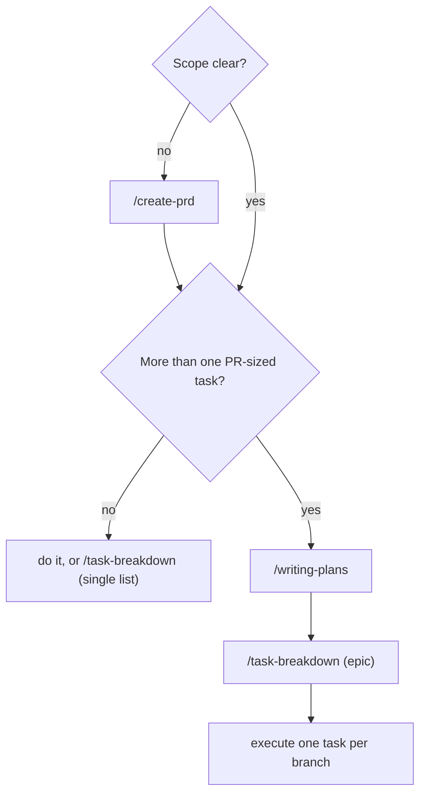

# Using Skills

Which skill to run, and when. Skills marked *command* have `disable-model-invocation: true`: agents never load them on their own, so run them explicitly (`/name`).

## Planning work

Answer two questions, in order:

1. **Is the scope clear?** Do you know the goal, the users, and what is in and out of scope? If not, run `/create-prd` first.
2. **Is it more than one PR-sized task?** If not, just do it, or run `/task-breakdown` for a single task list. If it is, run `/writing-plans` and then `/task-breakdown`, which writes an epic.

| Skill | Answers | Input | Output | Kind |
|---|---|---|---|---|
| `create-prd` | What and why: goals, user stories, requirements, non-goals | an idea | `tasks/prd-<feature>.md` | command |
| `writing-plans` | How: files, signatures, tests per task | a PRD, a spec, or scope agreed in chat | one plan | upstream (superpowers) |
| `task-breakdown` | In what pieces: a single list for one mergeable task, an epic (one file and branch per task) for more | a plan, a PRD, or requirements | `tasks/tasks-<feature>.md` or `tasks/<epic>/` | command |
| `executing-plans`, `subagent-driven-development` | Build it | a plan or an epic task | code | upstream (superpowers) |

Examples:

- New product or MVP: `/create-prd`, then `/writing-plans`, then `/task-breakdown`.
- Feature on an existing project, with the scope settled in conversation: `/writing-plans`, then `/task-breakdown`.
- One small change: do it directly, or `/task-breakdown`.
