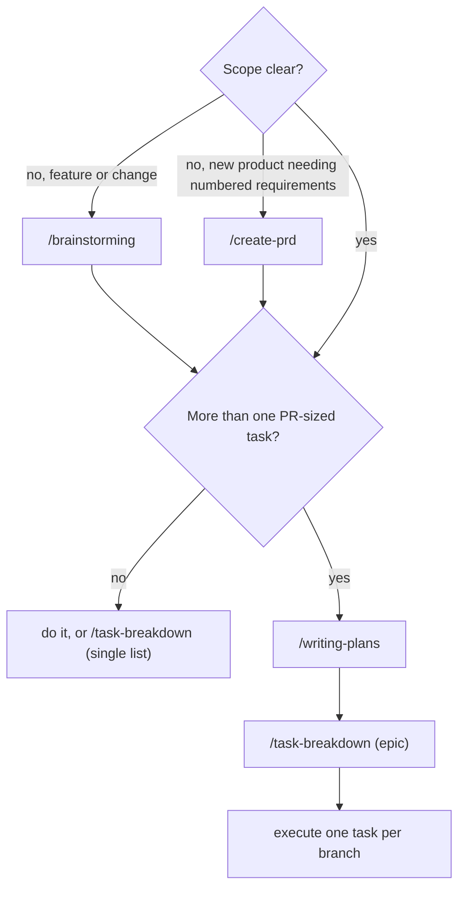

# Using Skills

Which skill to run, and when. Skills marked *command* have `disable-model-invocation: true`: agents never load them on their own, so run them explicitly (`/name`).

## Planning work

Answer two questions, in order:

1. **Is the scope clear?** Do you know the goal, the users, and what is in and out of scope? If not:
   - run `/brainstorming` by default: it settles what and why, then compares approaches and writes a spec;
   - run `/create-prd` instead for a new product or MVP whose tasks should cite numbered requirements (`FR 12`).
2. **Is it more than one PR-sized task?** If not, just do it, or run `/task-breakdown` for a single task list. If it is, run `/writing-plans` and then `/task-breakdown`, which writes an epic.

| Skill | Answers | Input | Output | Kind |
|---|---|---|---|---|
| `brainstorming` | What, why, and which approach: intent, goals and non-goals, constraints, approaches compared, the decided how | an idea or request | `.agents/docs/superpowers/specs/<date>-<topic>-design.md` | command, upstream (superpowers) |
| `create-prd` | What and why: user stories, numbered functional requirements, success metrics, deferred items | an idea | `tasks/prd-<feature>.md` | command |
| `writing-plans` | How: files, signatures, tests per task | a spec, a PRD, or scope agreed in chat | `.agents/docs/superpowers/plans/<date>-<feature>.md` | upstream (superpowers) |
| `task-breakdown` | In what pieces: a single list for one mergeable task, an epic (one file and branch per task) for more | a plan, a PRD, or requirements | `tasks/tasks-<feature>.md` or `tasks/<epic>/` | command |
| `executing-plans`, `subagent-driven-development` | Build it | a plan or an epic task | code | upstream (superpowers) |

`brainstorming` and `create-prd` are alternatives; run one, not both. A spec carries more than a PRD (the approaches and the decided how) but has no requirement ids to cite. `brainstorming` always hands off to `writing-plans`.

Examples:

- Feature or change on an existing project, scope unclear: `/brainstorming`, then `/writing-plans`, then `/task-breakdown`.
- Feature with the scope settled in conversation: `/writing-plans`, then `/task-breakdown`.
- New product or MVP: `/create-prd`, then `/writing-plans`, then `/task-breakdown`.
- One small change: do it directly, or `/task-breakdown`.
