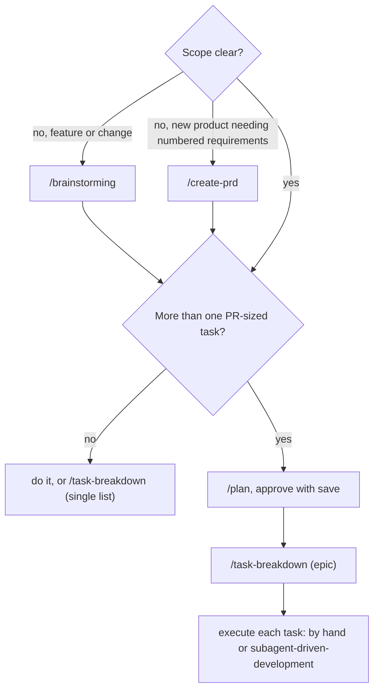

# Using Skills

Which skill to run, and when. Skills marked *command* have `disable-model-invocation: true`: agents never load them on their own, so run them explicitly (`/name`).

## Planning work

Answer two questions, in order:

1. **Is the scope clear?** Do you know the goal, the users, and what is in and out of scope? If not:
   - run `/brainstorming` by default: it settles what and why, then compares approaches and writes a spec;
   - run `/create-prd` instead for a new product or MVP whose tasks should cite numbered requirements (`FR 12`).
2. **Is it more than one PR-sized task?** If not, just do it, or run `/task-breakdown` for a single task list. If it is, run OMP's `/plan`, approve the plan with **save** (not execute), then run `/task-breakdown` in the same session, which writes an epic.

| Skill | Answers | Input | Output | Kind |
|---|---|---|---|---|
| `brainstorming` | What, why, and which approach: intent, goals and non-goals, constraints, approaches compared, the decided how | an idea or request | `.agents/docs/superpowers/specs/<date>-<topic>-design.md` | command, upstream (superpowers) |
| `create-prd` | What and why: user stories, numbered functional requirements, success metrics, deferred items | an idea | `tasks/prd-<feature>.md` | command |
| `/plan` | How, as decisions: approach, critical files, verification; explored read-only, enforced by OMP | a request, spec, or PRD | `local://<slug>-plan.md` (session-local) | OMP built-in mode |
| `task-breakdown` | In what pieces: a single list for one mergeable task, an epic (one file and branch per task) for more; each task with interfaces, tests, and verify steps | a plan, a spec, a PRD, or requirements | `tasks/tasks-<feature>.md` or `tasks/<epic>/` | command |
| `executing-plans`, `subagent-driven-development` | Build it | a task list or an epic task file | code | upstream (superpowers) |

Notes:

- `/plan` is not a skill: it is OMP's native plan mode, a harness mode that keeps the working tree read-only while the agent explores and ends with an approval prompt. It exists only in OMP.
- `brainstorming` and `create-prd` are alternatives; run one, not both. A spec carries more than a PRD (the approaches and the decided how) but has no requirement ids to cite.
- `brainstorming` ends by suggesting `writing-plans`; run `/plan` instead. `writing-plans` is no longer part of this flow: `task-breakdown` writes the per-task interfaces, tests, and verify steps it would add.
- `/plan` keeps its plan only in the session (`local://`). Run `/task-breakdown` before the session ends; it folds the plan into the epic README.
- `subagent-driven-development` runs on `task-breakdown` output directly: pass an epic task file (`task-brief 01-slug.md 01`) or a single list (`task-brief tasks-x.md 1`).

Examples:

- Feature or change on an existing project, scope unclear: `/brainstorming`, then `/plan`, then `/task-breakdown`.
- Feature with the scope settled in conversation: `/plan`, then `/task-breakdown`.
- New product or MVP: `/create-prd`, then `/plan`, then `/task-breakdown`.
- One small change: do it directly, or `/task-breakdown`.
