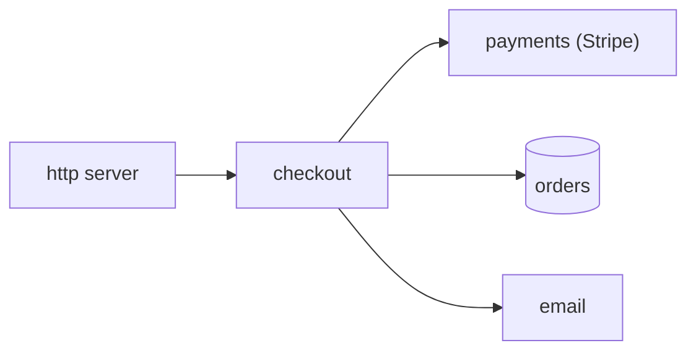
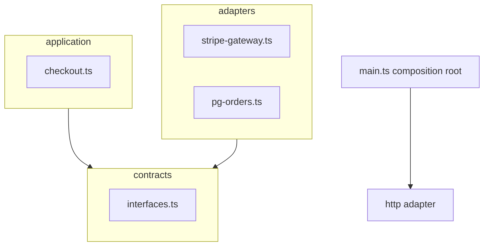

This is the architecture section of `docs/ARCHITECTURE.md` in a small shop backend:

````markdown
## Request flow



## Module dependencies



main.ts builds the adapters and passes them into checkout; checkout only knows the PaymentGateway and OrderRepo interfaces.
````

We just added pg-orders.ts using Postgres 16 on port 5432 and a Redis cache via ioredis. Update the Request flow diagram so it matches the code.

Reply with the updated Mermaid block for each diagram you change (or say that a diagram stays as it is), then one sentence for the reviewer or owner.
