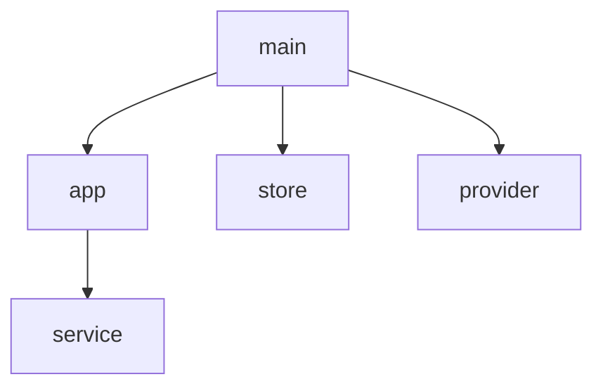
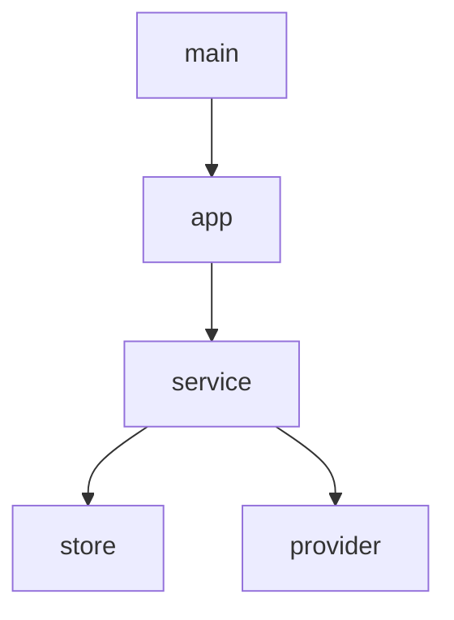

# Diagramming Dependency DAGs

## Overview

A dependency graph is a claim about what calls what. Draw only real usage, keep it acyclic, and take the layer boundaries from `designing-layered-architecture`.

**REQUIRED BACKGROUND:** Use `designing-layered-architecture` for layers, ports, and the composition root.

## Edge Rule

`A --> B` means **A uses B**: A imports, calls, or executes B at runtime.

Not an edge:

- A constructs B and passes it down.
- A receives B as a parameter.
- A names B in configuration.
- A declares B in a composition root.

Wiring is not usage. The composition root may know everything; only what it calls gets an arrow.

## Workflow

1. List candidate nodes and assign each a layer: composition root, policy/ports, adapters, framework/library, external system.
2. Write each edge as a sentence, "A uses B", and point to the call site, import, or exec. Drop any edge you cannot justify.
3. Check acyclicity **before** drawing. A cycle is an architecture bug: invert it with a port, move the shared piece, or merge the modules. Never hide it in the drawing.
4. Draw `flowchart TD` with one `subgraph` per layer, short labels, solid edges only. The composition root normally has a single outgoing edge, to the application entry.
5. Validate the block: parse the edges, run cycle detection on them, and re-read each edge against the rule.
6. Render it when the viewer supports Mermaid; otherwise say that only the syntax and edges were checked.

## Example

Bad — `store` and `provider` are constructed by `main` and passed down, not used by it:

Good:

## Layout

- Mermaid auto-layout decides positions; declaration order does not bind it.
- Prefer portable syntax. `%%{init: {"layout": "elk"}}%%` renders in mermaid-cli 11 but breaks ASCII/TUI renderers; add it only when the viewer is known to support it.
- Reduce crossings with short labels, one subgraph per layer, and the root at the top.
- If the renderer still crosses lines or ignores the layering, hand-draw an SVG instead of adding fake nodes or edges.

## Common Mistakes

| Mistake | Fix |
|---|---|
| Drawing injection as dependency (`main --> db`) | Draw only what the root calls |
| A config file as a node no module reads | Attach it to the module that reads it |
| A cycle "hidden" behind an interface | Redraw with the port; the adapter depends on the port |
| Mixing build-time imports with runtime process calls | Pick usage and state which one the arrows mean |
| Drawing every external tool | Include only what a module actually starts or calls |
| Two disconnected halves of the same graph | Find the missing real edge or the wrong node name |

## Validation Checklist

- Every edge reads as "A uses B" and is backed by a call, import, or exec.
- The composition root has no edge except to what it actually calls.
- The graph has no cycles.
- Every node is a module or a directly used external system.
- The diagram renders, or the rendering limitation is stated.
